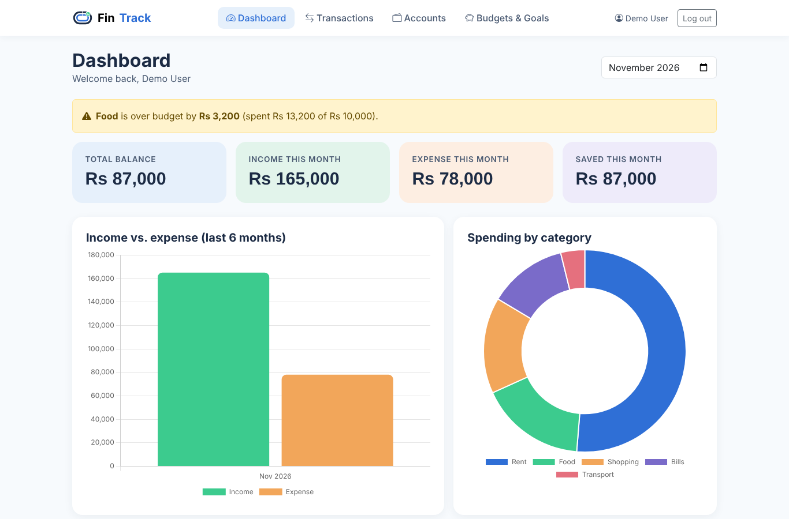
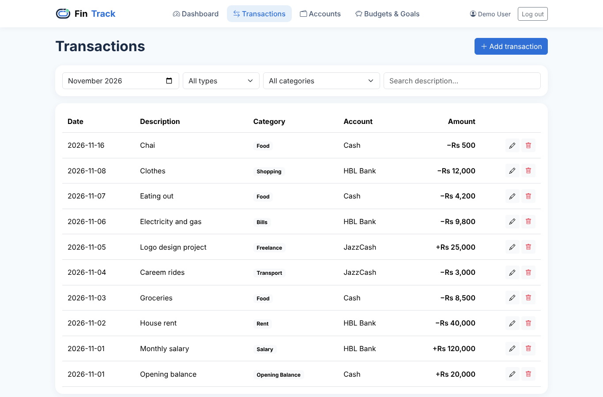
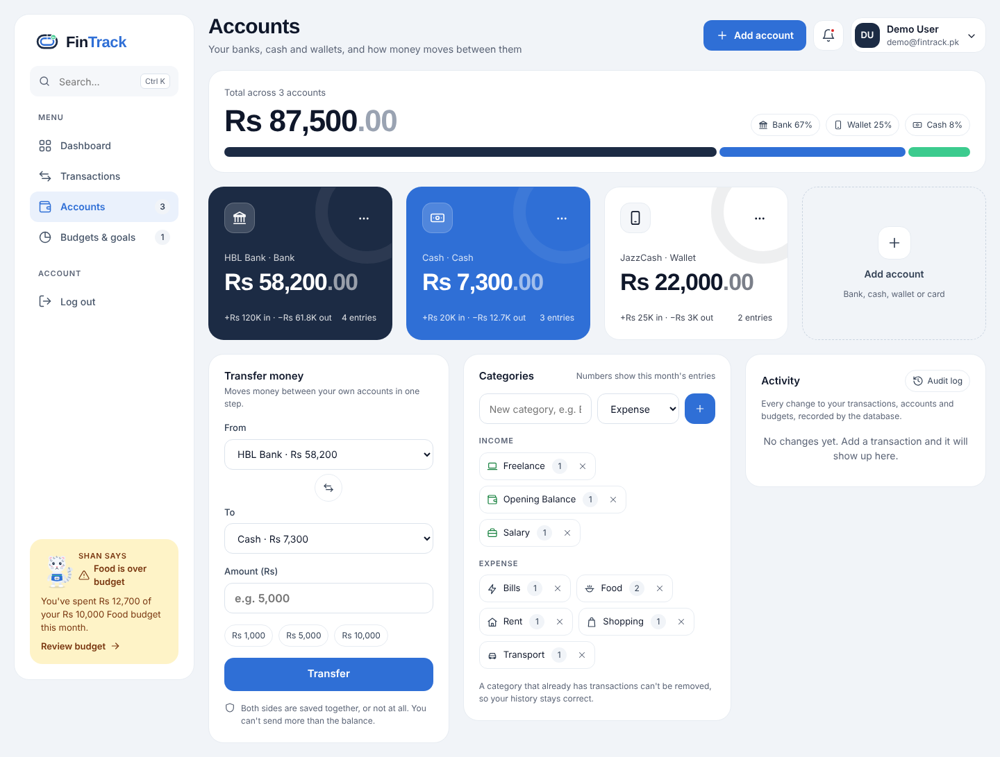
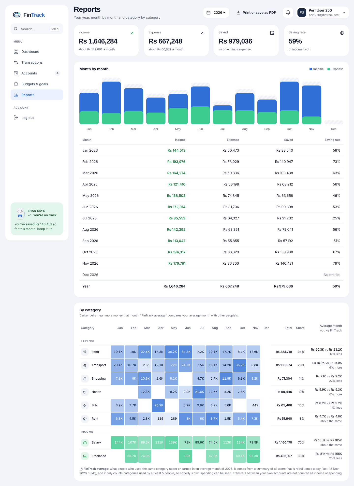
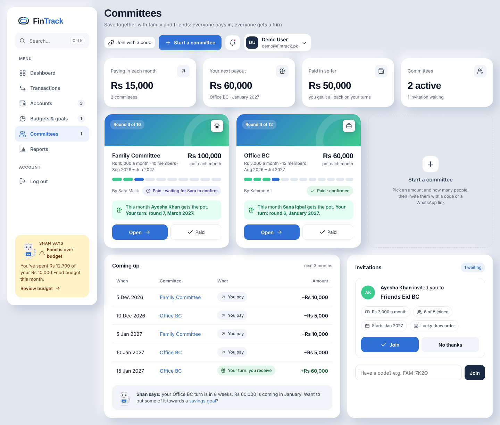
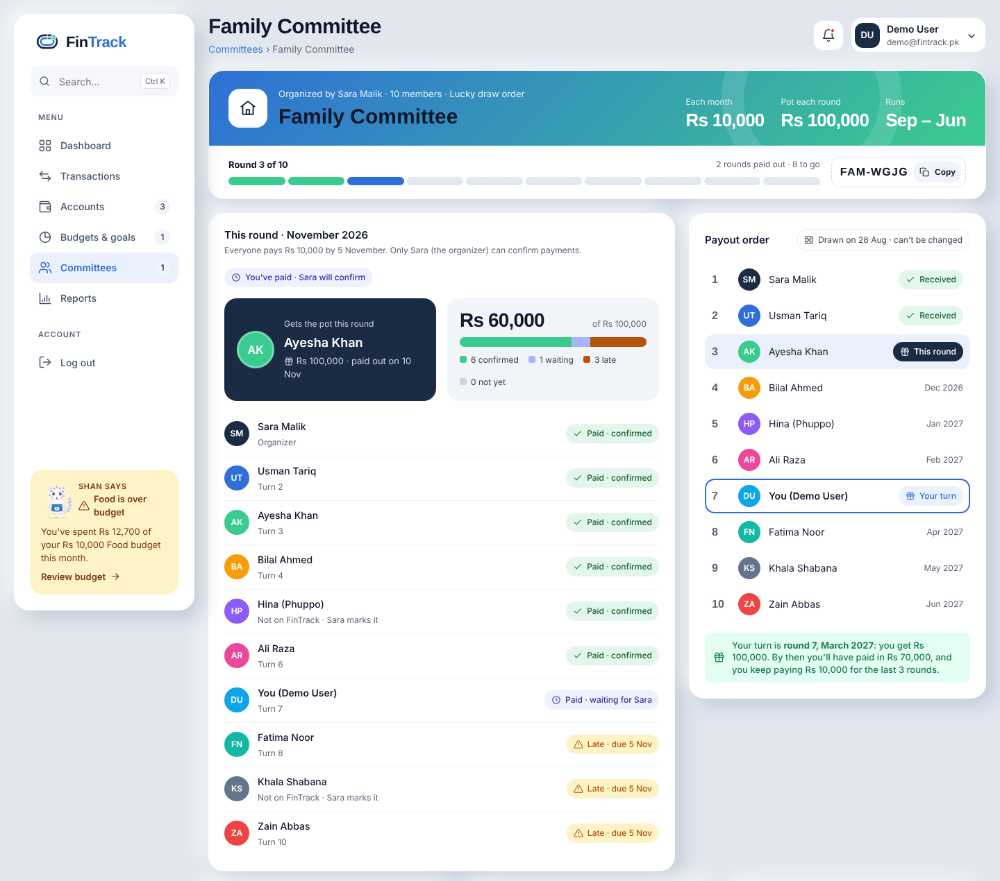
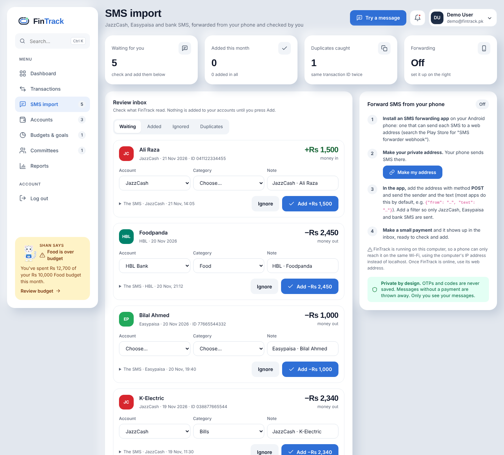
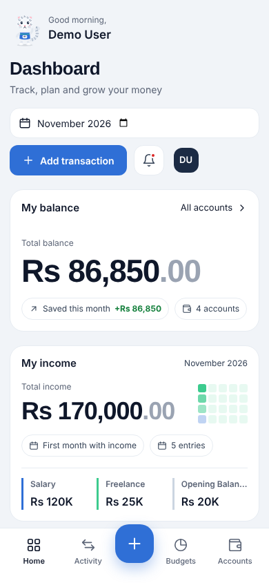

<p align="center">
  
</p>

<p align="center">
  <b>A personal finance management website backed by a PostgreSQL database.</b><br>
  Record income and expenses, set monthly budgets and reach your savings goals, all in one place.
</p>

<p align="center">
  
  
  
  
  
</p>

---

## About the project

FinTrack is our semester project for **CSC332L – Advance Database Management Systems Lab**.
Many students and families don't know where their money goes each month. FinTrack gives each user one place to
record every income and expense, see their balances on a dashboard, and get a warning when they spend more than their budget.

Money data has to be correct: no amount can be lost or counted twice. So most of the rules live **inside the
database itself** (keys, constraints, triggers, views, functions and transactions), not only in the website code.



## Features

| Module | What it does |
|--------|--------------|
| 👤 **User management** | Register, log in and log out. Passwords are stored as bcrypt hashes. |
| 🏦 **Accounts** | Bank, cash, wallet (JazzCash, Easypaisa) and card accounts with live balances. Transfer money between accounts. |
| 🏷️ **Categories** | Income and expense types such as Salary, Food, Rent and Bills. New users get a starter set. |
| 💸 **Transactions** | Add, edit, delete, search and filter income and expenses by month, type and category. |
| 🎯 **Budgets & goals** | Monthly spending limit per category, with progress bars, plus savings goals with a target and deadline. |
| 📩 **SMS import** | Your phone forwards JazzCash, Easypaisa and bank SMS to a private FinTrack address. FinTrack reads the amount, who, the transaction ID and the date, suggests an account and a category, and puts each one in a review inbox; nothing is added until you press Add. OTPs and non-payment messages are never saved, and duplicates are caught. |
| 🤝 **Committees (BC)** | Save together with family and friends: everyone pays the same amount each month and each month one person gets the whole pot. Start one, invite people with a code or a WhatsApp link, add guests who aren't on FinTrack, draw the payout order, and track who has paid. Payments and payouts can go straight into your FinTrack transactions. |
| 📊 **Dashboard & reports** | Total balance, this month's income and expense, a 6-month money-flow chart, budget usage, savings goals and budget warnings from Shan, our snow-leopard mascot. A **Reports** page shows the whole year by month and by category, compares each category with the average FinTrack user, and prints on two pages. |

## Database design

Six tables in third normal form (3NF). Each user owns their accounts, categories, budgets and goals; every
transaction belongs to one account and one category.

<p align="center"></p>

**Advanced database features used:**

- **Keys and constraints:** primary keys, foreign keys (`ON DELETE CASCADE` / `RESTRICT`), `UNIQUE`, `NOT NULL`, and `CHECK` (e.g. `amount > 0`, `saved_amount <= target_amount`).
- **Triggers (PL/pgSQL):** `accounts.balance` is updated automatically on every `INSERT`, `UPDATE` and `DELETE` of a transaction. A second trigger stops a transaction from using one user's account with another user's category.
- **Views:** `monthly_summary` (income vs. expense per month) and `category_spending` (total spent per category).
- **Function:** `check_budget(user_id, month)` returns the categories that are over budget.
- **Stored procedure + atomic transaction:** `transfer_money(from, to, amount)` writes both sides of a transfer as one unit; it fully succeeds or fully fails.
- **Audit log:** one generic `SECURITY DEFINER` trigger writes every INSERT, UPDATE and DELETE on transactions, accounts and budgets to an append-only `audit_log` (old and new row as JSONB, whose data it is, and who changed it). The website shows it as an **Activity** list.
- **Roles and privileges:** the website connects as `fintrack_app`, which can work with data but cannot drop or alter tables or touch the audit log; `fintrack_report` can only read the report views.
- **Committees:** `12_committees.sql` adds five tables (`committees`, `committee_members`, `committee_rounds`, `committee_payments`, `committee_events`), three enum types and the `committee_round_status` view. The database itself keeps committees fair: a trigger refuses more members than places (locking the committee row so two people can't take the last place at once), `UNIQUE` constraints give every member one turn, `start_committee()` draws or sets the order once under `SELECT … FOR UPDATE`, another trigger refuses a payout until every payment is confirmed (and never twice), and the history is append-only like the audit log.
- **SMS import:** `13_imports.sql` adds the review inbox (`imported_messages`), private forwarding keys (only their SHA-256 hash is stored) and two tables that remember your choices. A `UNIQUE` hash stops the same SMS being saved twice, a trigger marks a repeated transaction ID as a duplicate and suggests an account and a category, and `add_imported_message()` adds a message as a transaction exactly once, under `SELECT … FOR UPDATE`, checking that money in gets an income category and money out an expense one.
- **Indexes:** on `transactions(account_id, txn_date)`, `transactions(category_id)` and the `user_id` columns, to keep reports fast.

See [`database/`](database) for the SQL scripts and some queries to try.

## System flow

<p align="center"></p>

## Tech stack

| Part | Technology |
|------|------------|
| Database | PostgreSQL 14+ |
| Database management | pgAdmin 4 |
| Query language | SQL and PL/pgSQL |
| Front end | HTML5, CSS3, JavaScript, Bootstrap 5 (grid, menus, pop-ups); charts drawn with plain HTML and CSS |
| Back end | PHP 8 with PDO (`pdo_pgsql`), JWT login, bcrypt (`password_hash`) |

A web browser cannot connect to PostgreSQL directly, so a small PHP API sits between the website and the
database. This keeps the whole project in one language (JavaScript) and keeps the database password off the browser.

```
Browser (HTML/CSS/JS + Bootstrap)  ──►  PHP 8 + PDO API  ──►  PostgreSQL (pgAdmin 4)
```

## Project structure

```
FinTrack/
├── database/              SQL scripts (run in pgAdmin 4, in order)
│   ├── 01_schema.sql          tables, keys, constraints, indexes
│   ├── 02_triggers.sql        balance trigger + ownership check
│   ├── 03_views_functions.sql views, check_budget(), transfer_money()
│   ├── 04_seed.sql            sample data
│   ├── 05_audit.sql           audit log table and trigger
│   ├── 06_roles.sql           fintrack_app and fintrack_report roles
│   ├── 07_types.sql           money_pkr domain, account_kind and category_kind enums
│   ├── 08_login_attempts.sql  refuse a computer after 5 wrong passwords in 10 minutes
│   ├── 09_recurring.sql       recurring transactions and post_due_recurring()
│   ├── 10_reports.sql         materialized view of FinTrack-wide averages + refresh_reports()
│   ├── 11_indexes.sql         index from the performance study
│   ├── 12_committees.sql      committees (BC): members, rounds, payments, the one-time draw
│   ├── 13_imports.sql         SMS import: review inbox, forwarding keys, duplicates, add once
│   ├── perf/                  100,000+ row performance test (generate.sql, explain.sql)
│   ├── demo/                  two-window pgAdmin demo: transfers at the same moment; sample committees and SMS
│   └── tests/                 database tests (run in pgAdmin or with npm test)
├── Dockerfile, render.yaml how FinTrack runs online (see "Putting FinTrack online")
├── mobile/                the Android app (Capacitor) with automatic SMS import
├── backend/               PHP REST API
│   ├── .env.example           copy to .env and fill in
│   ├── router.php             entry point for `php -S` (sends /api/… to the API, serves the website)
│   ├── bin/                   install-db.php (database online in one command), post-recurring.php (daily job)
│   ├── tests/                 API tests (npm test; they start the PHP server themselves)
│   └── src/
│       ├── app.php            route table, login check and error messages
│       ├── db.php             PDO connection and "run as this user" helpers (audit log)
│       ├── jwt.php            login tokens (HS256)
│       ├── env.php, http.php  settings from .env, JSON in and out
│       ├── sms_parser.php     reads bank, JazzCash and Easypaisa SMS
│       └── routes/            auth, accounts, categories, transactions, budgets, goals, reports, activity, committees, imports
├── frontend/              the website
│   ├── index.html             log in / register
│   ├── dashboard.html         balance, income, expense, money flow, budget usage, goals
│   ├── reports.html           the year by month and category, printable
│   ├── transactions.html      list, filter, add, edit, delete
│   ├── accounts.html          accounts, transfers, categories
│   ├── budgets.html           budgets and savings goals
│   ├── imports.html           SMS import: review inbox and phone setup
│   ├── committees.html        your committees, what's coming up, invitations, join with a code
│   ├── committee.html         one committee: this round, payout order, members, history
│   ├── css/style.css          FinTrack theme
│   ├── js/api.js              shared API and helper code
│   ├── js/layout.js           sidebar, top bar, Shan's tips, phone tab bar
│   ├── js/committees.js       shared committee pieces: avatars, round bar, start and join pop-ups
│   ├── assets/                logo, Shan the mascot, log-in animation (SVG)
│   └── vendor/                Bootstrap (works offline)
└── docs/                  proposal, diagrams, logo, screenshots
```

## Getting started

### 1. Requirements

- [PostgreSQL](https://www.postgresql.org/download/) with **pgAdmin 4**
- **PHP 8.1 or newer** with the `pdo_pgsql` extension: on Windows install [XAMPP](https://www.apachefriends.org/) or the zip from [windows.php.net](https://windows.php.net/download/), then in `php.ini` remove the `;` in front of `extension=pdo_pgsql` and `extension=pgsql`. Check with `php -m` (the list must include `pdo_pgsql`).
- [Node.js](https://nodejs.org/) 18 or newer, only for running the tests

### 2. Create the database in pgAdmin 4

1. Open pgAdmin 4, right-click **Databases → Create → Database…** and name it `fintrack`.
2. Select `fintrack`, open **Tools → Query Tool**.
3. Open and run (F5) each file from the `database/` folder **in order**: `01_schema.sql`, `02_triggers.sql`, `03_views_functions.sql`, `04_seed.sql` (sample data), `05_audit.sql` (audit log), `06_roles.sql` (the `fintrack_app` and `fintrack_report` roles), `07_types.sql` (FinTrack's own data types), `08_login_attempts.sql` (log-in limit), `09_recurring.sql` (recurring transactions), `10_reports.sql` (report averages), `11_indexes.sql`, `12_committees.sql` (committees) and `13_imports.sql` (SMS import).
To try them with sample data, also run `database/demo/committees_demo.sql` and `database/demo/sms_demo.sql`, then log in as `demo@fintrack.pk` / `demo1234`.

**Already have a `fintrack` database from an earlier step?** Run just the files you don't have yet, in order. Since step 5: `03_views_functions.sql` (faster `check_budget()`), `10_reports.sql` and `11_indexes.sql`. For committees: `12_committees.sql` (and `demo/committees_demo.sql` for sample committees). For SMS import: `13_imports.sql` (and `demo/sms_demo.sql`). Your data stays.

Or from a terminal:

```bash
createdb -U postgres fintrack
for f in database/[0-9][0-9]_*.sql; do psql -U postgres -d fintrack -f "$f"; done
```

### 3. Configure and start the server

```bash
cd backend
cp .env.example .env        # then set PGADMIN_PASSWORD (your postgres password) and JWT_SECRET
php -S localhost:3000 -t ../frontend router.php
```

Open **http://localhost:3000** in your browser.

**Demo login** (from the sample data): `demo@fintrack.pk` / `demo1234`

**Recurring transactions** (rent every month, a bus pass every week) are posted when you log in. If nobody logs in for a while, a daily job can post them; on Windows, once, in PowerShell (change the path to your PHP and FinTrack folders):

```powershell
schtasks /Create /SC DAILY /ST 06:00 /TN "FinTrack recurring" /TR "php D:\FinTrack\backend\bin\post-recurring.php"
```

**If it says "Database password not set":** the PHP server or tests could not read `backend/.env`. On Windows, Notepad often saves it as `.env.txt`; rename it with `Rename-Item .env.txt .env`, and make sure it has a `PGPASSWORD=` line. If PostgreSQL is installed in a different folder or port, set `PGPORT` to match (check with `Get-Service *postgres*` and the `port =` line in `postgresql.conf`).

## Putting FinTrack online

FinTrack runs online as one small Docker container on **Render** (the PHP API and the pages) with the database on **Neon** (free PostgreSQL that doesn't expire). The repository already has what's needed: a `Dockerfile`, `render.yaml` and a one-command database installer.

1. **Database (Neon).** Make a free project at [neon.com](https://neon.com) and copy its connection string (Dashboard → Connect). On your computer, from the `backend` folder:
   ```bash
   php bin/install-db.php "postgresql://neondb_owner:<password>@<host>/neondb?sslmode=require" --with-demo
   ```
   It runs every script in `database/` in order, gives the website's account (`fintrack_app`) a new random password, and prints the `DATABASE_URL` for the website. It refuses to install over an existing FinTrack database unless you add `--reset` (which deletes its data). Leave out `--with-demo` for no sample committees and SMS.
2. **Website (Render).** On [render.com](https://render.com): New → Blueprint → this repository. Render reads `render.yaml`, builds the `Dockerfile`, makes a random `JWT_SECRET`, and asks for `DATABASE_URL`: paste the line the installer printed. FinTrack is then live at `https://fintrack-….onrender.com`.

Good to know:
- On the free plan Render puts the service to sleep after 15 minutes without visits; the next visit takes about a minute to wake it.
- The website connects only as `fintrack_app`, which can't change the tables; the owner's connection string stays on your computer.
- Settings for online use (`DATABASE_URL`, `CLIENT_IP_HEADER`, `CORS_ORIGINS`) are explained in `backend/.env.example`.
- CI builds the Docker image and runs it against a database made by the installer on every pull request.

## Android app

`mobile/` turns FinTrack into an Android app with Capacitor. Inside it, **SMS import → Turn on automatic SMS** makes the phone send bank, JazzCash and Easypaisa SMS to the review inbox by itself: only from bank and wallet senders, only payments, never personal messages or codes, retrying until the server answers. CI builds the APK on every pull request (Actions → CI run → Artifacts → **FinTrack-android**). Details in [mobile/README.md](mobile/README.md).

## Running the tests

```bash
cd backend
npm install                 # once: the test tools
npm test
```

This rebuilds a separate database called `fintrack_test` from the scripts in `database/` (your real `fintrack` database is never touched), then runs:

- **Database tests** (`database/tests/*.sql`): constraints, triggers, views, `check_budget()` and `transfer_money()`. You can also open any of these files in pgAdmin's Query Tool and run them; each passing check prints `PASS <rule>` and nothing is changed.
- **API tests** (`backend/tests/api.test.js`): the tests start the PHP server on a free port and call every route over HTTP, including privacy checks where a second user tries to read or change the first user's data.
- **Two-session test** (`backend/tests/concurrency.test.js`): two database connections transfer money at the same moment; the second must wait and be refused (DB-13).

The same tests run automatically on GitHub for every pull request (see the **Actions** tab).

## Performance

With 285,000 generated transactions, the indexes make every page's queries 87 – 650 × faster (0.07 – 0.4 ms instead of 17 – 64 ms), and the FinTrack-wide averages come from a materialized view in 0.05 ms instead of 197 ms. The full study, with query plans and how to repeat it, is in **[docs/performance.md](docs/performance.md)**.

## API reference

All routes except `/api/auth/*` need the header `Authorization: Bearer <token>`.

| Method | Route | Description |
|--------|-------|-------------|
| POST | `/api/auth/register` | Create an account `{ full_name, email, password }` |
| POST | `/api/auth/login` | Log in `{ email, password }` → `{ token, user }`; after 5 wrong passwords in 10 minutes, `429` until the 10 minutes pass |
| GET / POST | `/api/accounts` | List / add accounts |
| PUT / DELETE | `/api/accounts/:id` | Edit / delete an account |
| POST | `/api/accounts/transfer` | Move money `{ from_account, to_account, amount }` |
| GET / POST | `/api/categories` | List / add categories |
| PUT / DELETE | `/api/categories/:id` | Rename `{ name }` / delete a category |
| GET | `/api/transactions` | List; filters `?month=2026-11&type=expense&category_id=&account_id=&search=`; pages with `&limit=50`, next page `&before_date=&before_id=` (date and id of the last row) |
| GET / POST | `/api/recurring` | List / add a recurring transaction `{ account_id, category_id, amount, description, frequency: weekly\|monthly, start_date }`; due dates are posted at once |
| PUT / DELETE | `/api/recurring/:id` | Pause or resume `{ is_active }`, change `{ amount, description }` / stop repeating (posted transactions stay) |
| POST | `/api/transactions` | Add `{ account_id, category_id, amount, txn_date, description }` |
| PUT / DELETE | `/api/transactions/:id` | Edit / delete a transaction |
| GET / POST | `/api/budgets` | List for `?month=` / set a budget `{ category_id, limit_amount, month }` |
| DELETE | `/api/budgets/:id` | Delete a budget |
| GET / POST | `/api/goals` | List / add savings goals |
| PATCH | `/api/goals/:id/add` | Add savings to a goal `{ amount }` |
| DELETE | `/api/goals/:id` | Delete a goal |
| GET | `/api/reports/dashboard?month=` | Totals, charts data and budget warnings |
| GET | `/api/reports/year?year=2026` | The year by month and by category, and the FinTrack average per category |
| GET | `/api/activity?limit=20` | The user's audit log as plain sentences, newest first |
| GET / POST | `/api/committees` | Your committees and invitations / start one `{ name, amount, member_count, start_month: "2026-12", due_day, payout_day, payout_method: draw\|fixed\|organizer }` |
| GET | `/api/committees/code?code=FAM-7K2Q` | Preview a committee before joining |
| POST | `/api/committees/join` | Ask to join `{ code }` (accepts an invitation straight away) |
| GET / DELETE | `/api/committees/:id` | Everything a member sees / delete (organizer, before the start) |
| POST | `/api/committees/:id/accept` | Accept an invitation |
| POST | `/api/committees/:id/invite` · `/guests` | Organizer: invite a FinTrack user `{ email }` · add a guest `{ display_name }` |
| POST / DELETE | `/api/committees/:id/members/:member/approve` · `/members/:member` | Organizer approves a request / remove someone, leave, or say no (before the start) |
| POST | `/api/committees/:id/start` | Organizer: draw or set the order `{ order?: [member ids] }` and create the rounds |
| PUT | `/api/committees/:id/link` | Add my payments and payout to an account `{ account_id \| null }` |
| POST | `/api/committees/:id/rounds/:round/paid` | "I've paid" for the current round |
| POST | `/api/sms/:key` | **No log-in:** the phone's forwarding app sends `{ from, text }` (JSON, a form, or plain text) |
| GET / POST / DELETE | `/api/sms/key` | Is forwarding on / make a new private address (shown once) / turn it off |
| GET | `/api/imports?status=pending\|added\|ignored\|duplicate\|all` | The review inbox, with counts and a possible match already typed in |
| POST | `/api/imports/test` | Try a message `{ text, sender? }` without a phone |
| POST | `/api/imports/:id/add` | Add it as a transaction `{ account_id, category_id, amount?, txn_date?, description? }` |
| POST / DELETE | `/api/imports/:id/ignore` · `/restore` · `/api/imports/:id` | Ignore / back to the inbox / delete the message |
| POST | `/api/committees/:id/rounds/:round/confirm` · `/payout` | Organizer: confirm a payment `{ member_id }` · pay out the pot `{ receiver_member_id? }` |

## Screenshots

| Log in | Transactions |
|--------|--------------|
|  |  |
| **Accounts** | **Budgets & goals** |
|  |  |
| **Reports** | **Committees** |
|  |  |
| **A committee** | **SMS import** |
|  |  |

On a phone the sidebar becomes a bottom tab bar with a big "+" for adding a transaction:



## Project plan (6 weeks)

| Task | W1 | W2 | W3 | W4 | W5 | W6 |
|------|:--:|:--:|:--:|:--:|:--:|:--:|
| Requirements and ER diagram | 🟦 | | | | | |
| Create database and tables in pgAdmin 4 | 🟦 | 🟦 | | | | |
| Triggers, views, functions and indexes | | 🟦 | 🟦 | | | |
| Front-end pages (HTML, CSS, Bootstrap) | | 🟦 | 🟦 | 🟦 | | |
| Back end (PHP + PDO) and database connection | | | 🟦 | 🟦 | 🟦 | |
| Testing and bug fixing | | | | | 🟦 | 🟦 |
| Final report and presentation | | | | | | 🟦 |

The full proposal is in [`docs/FinTrack_ADBMS_Lab_Proposal.pdf`](docs/FinTrack_ADBMS_Lab_Proposal.pdf).

## Team

| Name | ID | Role |
|------|----|------|
| **Ahmad Malik** | 41171 | Database design, triggers and functions |
| **M. Mehdi Kazmi** | 41471 | Front end and Bootstrap pages |
| **Abduallah Amjad** | 41195 | Back end, testing and report |

**Course:** CSC332L – Advance Database Management Systems Lab, Iqra University
**Instructor:** Ms. Zill-e-Huma Minhas

## License

This project is released under the [MIT License](LICENSE).
