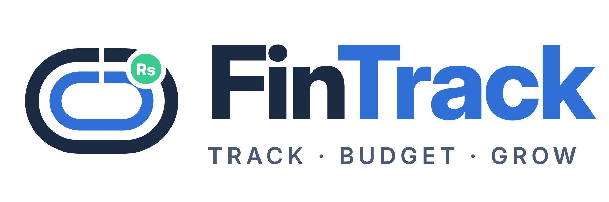
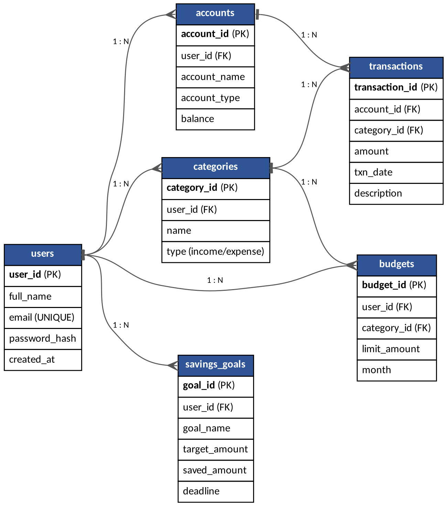
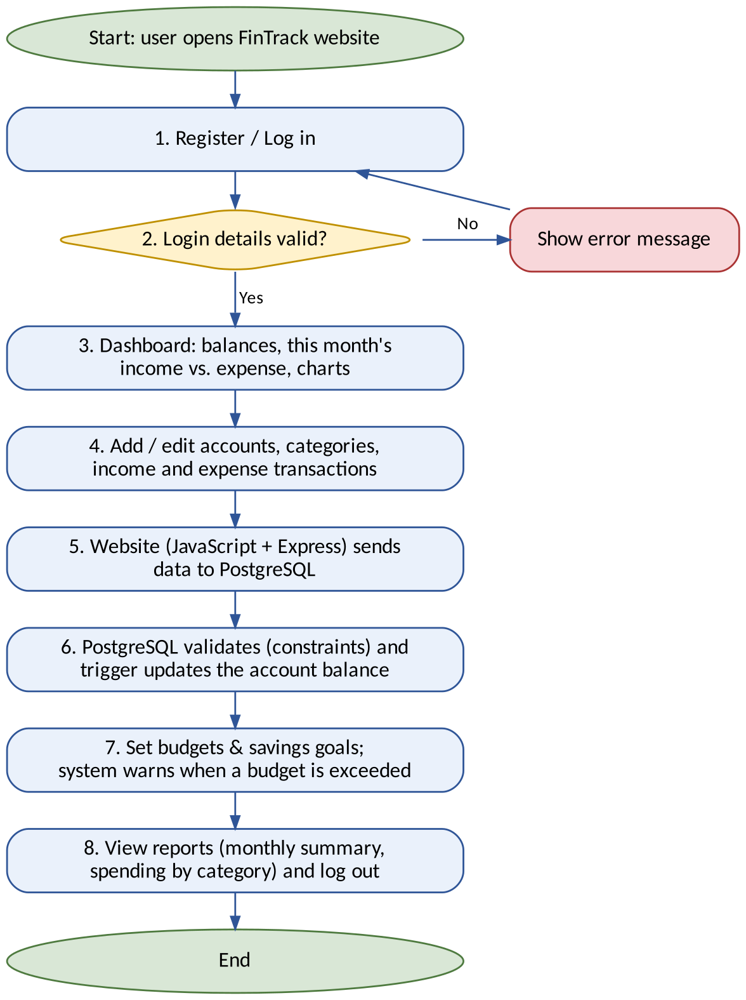
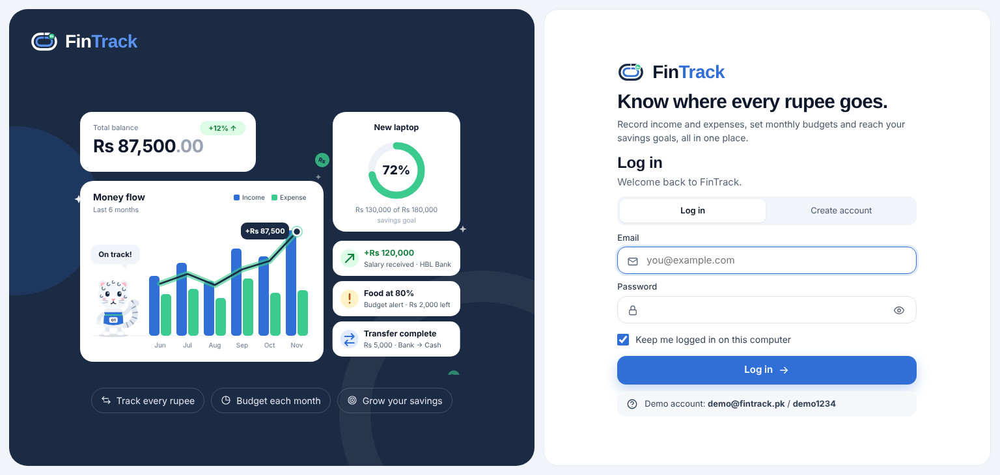
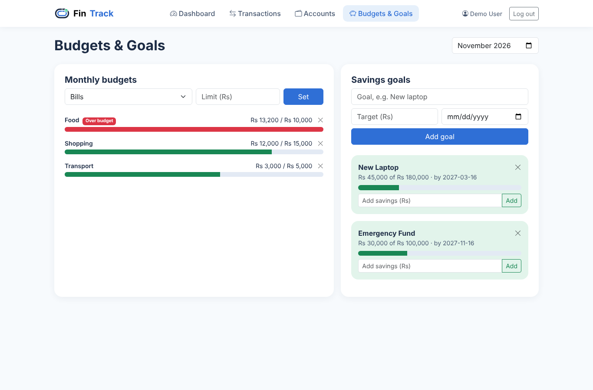

<p align="center">
  
</p>

<p align="center">
  <b>A personal finance management website backed by a PostgreSQL database.</b><br>
  Record income and expenses, set monthly budgets and reach your savings goals, all in one place.
</p>

<p align="center">
  
  
  
  
  
  
  
</p>

---

## About the project

FinTrack is our semester project for **CSC332L – Advance Database Management Systems Lab**.
Many students and families don't know where their money goes each month. FinTrack gives each user one place to
record every income and expense, see their balances on a dashboard, and get a warning when they spend more than their budget.

Money data has to be correct: no amount can be lost or counted twice. So most of the rules live **inside the
database itself** (keys, constraints, triggers, views, functions and transactions), not only in the website code.


## Features

| Module | What it does |
|--------|--------------|
| 👤 **User management** | Register, log in and log out. Passwords are stored as bcrypt hashes. |
| 🏦 **Accounts** | Bank, cash, wallet (JazzCash, Easypaisa) and card accounts with live balances. Transfer money between accounts. |
| 🏷️ **Categories** | Income and expense types such as Salary, Food, Rent and Bills. New users get a starter set. |
| 💸 **Transactions** | Add, edit, delete, search and filter income and expenses by month, type and category. |
| 🎯 **Budgets & goals** | Monthly spending limit per category, with progress bars, plus savings goals with a target and deadline. |
| 📊 **Dashboard & reports** | Total balance, this month's income vs. expense, 6-month trend chart, spending by category and budget warnings. |

## Database design

Six tables in third normal form (3NF). Each user owns their accounts, categories, budgets and goals; every
transaction belongs to one account and one category.

<p align="center"></p>

**Advanced database features used:**

- **Keys and constraints:** primary keys, foreign keys (`ON DELETE CASCADE` / `RESTRICT`), `UNIQUE`, `NOT NULL`, and `CHECK` (e.g. `amount > 0`, `saved_amount <= target_amount`).
- **Triggers (PL/pgSQL):** `accounts.balance` is updated automatically on every `INSERT`, `UPDATE` and `DELETE` of a transaction. A second trigger stops a transaction from using one user's account with another user's category.
- **Views:** `monthly_summary` (income vs. expense per month) and `category_spending` (total spent per category).
- **Function:** `check_budget(user_id, month)` returns the categories that are over budget.
- **Stored procedure + atomic transaction:** `transfer_money(from, to, amount)` writes both sides of a transfer as one unit; it fully succeeds or fully fails.
- **Audit log:** one generic `SECURITY DEFINER` trigger writes every INSERT, UPDATE and DELETE on transactions, accounts and budgets to an append-only `audit_log` (old and new row as JSONB, whose data it is, and who changed it). The website shows it as an **Activity** list.
- **Roles and privileges:** the website connects as `fintrack_app`, which can work with data but cannot drop or alter tables or touch the audit log; `fintrack_report` can only read the report views.
- **Indexes:** on `transactions(account_id, txn_date)`, `transactions(category_id)` and the `user_id` columns, to keep reports fast.

See [`database/`](database) for the SQL scripts and some queries to try.

## System flow

<p align="center"></p>

## Tech stack

| Part | Technology |
|------|------------|
| Database | PostgreSQL 14+ |
| Database management | pgAdmin 4 |
| Query language | SQL and PL/pgSQL |
| Front end | HTML5, CSS3, JavaScript, Bootstrap 5, Bootstrap Icons |
| Charts | Chart.js |
| Back end | Node.js + Express, `pg` driver, JWT login, bcrypt |

A web browser cannot connect to PostgreSQL directly, so a small Express server sits between the website and the
database. This keeps the whole project in one language (JavaScript) and keeps the database password off the browser.

```
Browser (HTML/CSS/JS + Bootstrap)  ──►  Node.js + Express API  ──►  PostgreSQL (pgAdmin 4)
```

## Project structure

```
FinTrack/
├── database/              SQL scripts (run in pgAdmin 4, in order)
│   ├── 01_schema.sql          tables, keys, constraints, indexes
│   ├── 02_triggers.sql        balance trigger + ownership check
│   ├── 03_views_functions.sql views, check_budget(), transfer_money()
│   ├── 04_seed.sql            sample data
│   ├── 05_audit.sql           audit log table and trigger
│   ├── 06_roles.sql           fintrack_app and fintrack_report roles
│   └── tests/                 database tests (run in pgAdmin or with npm test)
├── backend/               Express REST API
│   ├── .env.example           copy to .env and fill in
│   ├── tests/                 API tests (npm test)
│   └── src/
│       ├── server.js          starts the app
│       ├── app.js             routes, website files and error handling
│       ├── db.js              PostgreSQL connection pool
│       ├── middleware/auth.js JWT login check
│       └── routes/            auth, accounts, categories, transactions, budgets, goals, reports
├── frontend/              the website
│   ├── index.html             log in / register
│   ├── dashboard.html         stats, charts, budget warnings
│   ├── transactions.html      list, filter, add, edit, delete
│   ├── accounts.html          accounts, transfers, categories
│   ├── budgets.html           budgets and savings goals
│   ├── css/style.css          FinTrack theme
│   ├── js/api.js              shared API and helper code
│   └── vendor/                Bootstrap, icons, Chart.js (works offline)
└── docs/                  proposal, diagrams, logo, screenshots
```

## Getting started

### 1. Requirements

- [PostgreSQL](https://www.postgresql.org/download/) with **pgAdmin 4**
- [Node.js](https://nodejs.org/) 18 or newer

### 2. Create the database in pgAdmin 4

1. Open pgAdmin 4, right-click **Databases → Create → Database…** and name it `fintrack`.
2. Select `fintrack`, open **Tools → Query Tool**.
3. Open and run (F5) each file from the `database/` folder **in order**: `01_schema.sql`, `02_triggers.sql`, `03_views_functions.sql`, `04_seed.sql` (sample data), `05_audit.sql` (audit log) and `06_roles.sql` (the `fintrack_app` and `fintrack_report` roles).

Or from a terminal:

```bash
createdb -U postgres fintrack
for f in database/0*.sql; do psql -U postgres -d fintrack -f "$f"; done
```

### 3. Configure and start the server

```bash
cd backend
cp .env.example .env        # then set PGADMIN_PASSWORD (your postgres password) and JWT_SECRET
npm install
npm start
```

Open **http://localhost:3000** in your browser.

**Demo login** (from the sample data): `demo@fintrack.pk` / `demo1234`

**If it says "Database password not set":** the server or tests could not read `backend/.env`. On Windows, Notepad often saves it as `.env.txt`; rename it with `Rename-Item .env.txt .env`, and make sure it has a `PGPASSWORD=` line. If PostgreSQL is installed in a different folder or port, set `PGPORT` to match (check with `Get-Service *postgres*` and the `port =` line in `postgresql.conf`).

## Running the tests

```bash
cd backend
npm test
```

This rebuilds a separate database called `fintrack_test` from the scripts in `database/` (your real `fintrack` database is never touched), then runs:

- **Database tests** (`database/tests/*.sql`): constraints, triggers, views, `check_budget()` and `transfer_money()`. You can also open any of these files in pgAdmin's Query Tool and run them; each passing check prints `PASS <rule>` and nothing is changed.
- **API tests** (`backend/tests/api.test.js`): every route, including privacy checks where a second user tries to read or change the first user's data.

The same tests run automatically on GitHub for every pull request (see the **Actions** tab).

## API reference

All routes except `/api/auth/*` need the header `Authorization: Bearer <token>`.

| Method | Route | Description |
|--------|-------|-------------|
| POST | `/api/auth/register` | Create an account `{ full_name, email, password }` |
| POST | `/api/auth/login` | Log in `{ email, password }` → `{ token, user }` |
| GET / POST | `/api/accounts` | List / add accounts |
| PUT / DELETE | `/api/accounts/:id` | Edit / delete an account |
| POST | `/api/accounts/transfer` | Move money `{ from_account, to_account, amount }` |
| GET / POST | `/api/categories` | List / add categories |
| DELETE | `/api/categories/:id` | Delete a category |
| GET | `/api/transactions` | List; filters `?month=2026-11&type=expense&category_id=&account_id=&search=` |
| POST | `/api/transactions` | Add `{ account_id, category_id, amount, txn_date, description }` |
| PUT / DELETE | `/api/transactions/:id` | Edit / delete a transaction |
| GET / POST | `/api/budgets` | List for `?month=` / set a budget `{ category_id, limit_amount, month }` |
| DELETE | `/api/budgets/:id` | Delete a budget |
| GET / POST | `/api/goals` | List / add savings goals |
| PATCH | `/api/goals/:id/add` | Add savings to a goal `{ amount }` |
| DELETE | `/api/goals/:id` | Delete a goal |
| GET | `/api/reports/dashboard?month=` | Totals, charts data and budget warnings |
| GET | `/api/activity?limit=20` | The user's audit log as plain sentences, newest first |

## Screenshots

| Log in | Transactions |
|--------|--------------|
|  |  |
| **Accounts** | **Budgets & goals** |
|  |  |

## Project plan (6 weeks)

| Task | W1 | W2 | W3 | W4 | W5 | W6 |
|------|:--:|:--:|:--:|:--:|:--:|:--:|
| Requirements and ER diagram | 🟦 | | | | | |
| Create database and tables in pgAdmin 4 | 🟦 | 🟦 | | | | |
| Triggers, views, functions and indexes | | 🟦 | 🟦 | | | |
| Front-end pages (HTML, CSS, Bootstrap) | | 🟦 | 🟦 | 🟦 | | |
| Back end (Node.js/Express) and database connection | | | 🟦 | 🟦 | 🟦 | |
| Testing and bug fixing | | | | | 🟦 | 🟦 |
| Final report and presentation | | | | | | 🟦 |

The full proposal is in [`docs/FinTrack_ADBMS_Lab_Proposal.pdf`](docs/FinTrack_ADBMS_Lab_Proposal.pdf).

## Team

| Name | ID | Role |
|------|----|------|
| **Ahmad Malik** | 41171 | Database design, triggers and functions |
| **M. Mehdi Kazmi** | 41471 | Front end and Bootstrap pages |
| **Abduallah Amjad** | 41195 | Back end, testing and report |

**Course:** CSC332L – Advance Database Management Systems Lab, Iqra University
**Instructor:** Ms. Zill-e-Huma Minhas

## License

This project is released under the [MIT License](LICENSE).
